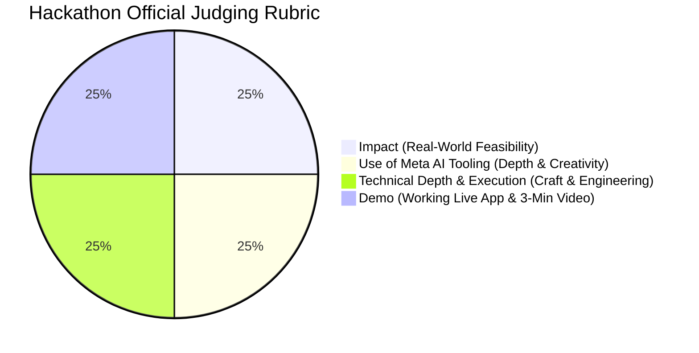
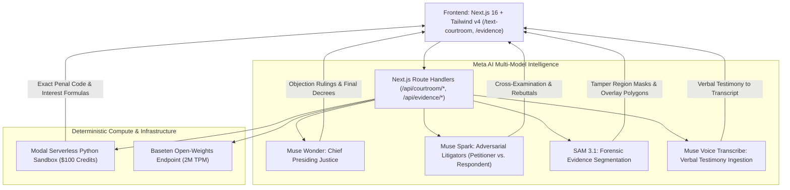

# AI Judge — Meta Global AI Hackathon Master Blueprint

**Event:** Meta Global AI Developer Hackathon (Hosted by Meta & Cerebral Valley)  
**Timeline:** 10-Day Sprint (Oct 26, 2026 – Nov 4, 2026 at 9:00 PM EST)  
**Submission Portal:** [Cerebral Valley Submission Portal](https://cerebralvalley.ai/e/meta-ai-developer-hackathon/hackathon/submit)  
**Total Prize Pool:** $1,000,000 Cash Prizes across Indie Developer ($400K) & Startup ($550K) Tracks + $50K Bonus Awards  
**Primary Target:** 1st Place Indie Developer Track ($150,000) + Best Agentic Use-Case ($5,000) + Best Build on Open Weights ($10,000)

---

## 1. Problem Statement Alignment & Anti-Project Avoidance

### A. Chosen Theme: *Build for Your World* + *Push the Frontier*
- **Build for Your World:** Directly tackles the crushing crisis of judicial backlogs and prohibitive legal costs by providing an autonomous, multimodal virtual courtroom platform for rapid dispute resolution under Indian statutory law (BNS, BSA, CPC).
- **Push the Frontier:** Pushes autonomous agent coordination into multi-agent adversarial debate (Petitioner Counsel vs. Respondent Counsel mediated by a Chief Presiding Justice) coupled with zero-shot forensic evidence segmentation via SAM 3.1.

### B. Anti-Project Guardrail (Official Rules Compliance)
The official rules strictly ban generic projects:
> *"Avoid building: Basic RAG Applications, Simple Image Analyzers, Simple AI for Education Chatbots, AI Job Application Screener, Nutrition Coach, Sports Analyzers."*

**AI Judge is completely differentiated:** It is **NOT** a simple chatbot or RAG wrapper. It is an end-to-end autonomous digital courtroom with:
1. Multi-agent adversarial litigation loops (Muse Spark).
2. Deep judicial deliberation & formal decree synthesis (Muse Wonder).
3. Zero-shot pixel-accurate forensic evidence inspection (SAM 3.1).
4. Deterministic statutory & penalty computations via serverless code execution (Modal Python sandbox).
5. Voice record transcription for courtroom hearings (Muse Voice Transcribe).

---

## 2. Meta Tooling & Partner Credit Activation Matrix

| Tool / Infrastructure | Role in AI Judge | Credits / Allocation | Activation Link |
| :--- | :--- | :--- | :--- |
| **Meta Model API** | Hosted API for Muse Wonder, Muse Spark, SAM 3.1, Muse Voice Transcribe | **$150 Meta Credits** | Credit claim link rolling out on CV portal. Credit card on file (spend limits enabled). |
| **Muse Code CLI (`muse`)** | Primary autonomous backend coding agent running in local PowerShell terminal | Free Native Developer Tooling | `irm https://dev.meta.ai/install.ps1 \| iex` |
| **Modal Infrastructure** | Serverless Python sandboxes for exact statutory penal code lookup, penalty formulas, and SHA-256 BSA hashes | **$100 Credits** (First 1,000 applicants) | [Modal Hackathon Form](https://docs.google.com/forms/d/e/1FAIpQLSe_GDPtLZsdA57xPhFcOCi_yLjPf8HRxMIQJ5V7ystoKSqWCQ/viewform) |
| **Baseten Inference** | Dedicated open-weights serving with **2M TPM rate limits** for `meta-models/muse-spark-open-1026` | **$100 Credits** (First 2,000 applicants) | [Baseten Hackathon Form](https://docs.google.com/forms/d/e/1FAIpQLSfM7gcK8yMZEmAGq6DbTyiuv2c71IH7CKCy0fXGIfUED1qxVQ/viewform) |
| **Fireworks AI** | Low-latency inference endpoints & prompt chaining | **$25 Credits** | [Fireworks Hackathon Form](https://docs.google.com/forms/d/e/1FAIpQLSdPQTTES8_nhavzZkOrebVNYbM1FumWLdpeZx8ZSNe4QLXKPA/viewform) |

---

## 3. Official Judging Rubric (Scale 0–10, Equally Weighted)

Judges evaluate submissions across 4 equal pillars:

1. **Impact (25%):** Real-world legal potential, solving court backlog, accessibility for litigants.
2. **Use of Meta AI Tooling (25%):** Beyond a basic wrapper. Harnessing Muse Wonder (reasoning), Muse Spark (low latency MoE), SAM 3.1 (segmentation), and Muse Voice Transcribe (audio hearings).
3. **Technical Depth & Execution (25%):** Next.js 16 App Router, TypeScript type safety, Modal serverless sandbox execution, zero hallucination on statutes.
4. **Demo (25%):** Seamless 3-minute video showing live human-versus-AI counsel litigation, SAM 3.1 evidence tampering detection, and instantaneous judicial decree issuance.

---

## 4. Multi-Tier Target Bonus Awards

In addition to the **$150,000 1st Place Indie Track** prize, AI Judge is engineered to compete for:
- **Best Agentic Use-Case ($5,000):** Multi-agent coordination where AI advocates litigate and an AI Judge presides autonomously.
- **Best Build on Meta Open Weight Models ($10,000):** Running `meta-models/muse-spark-open-1026` through Baseten or Modal.
- **Most Viral Project ($20,000):** Publishing a dramatic courtroom clip on X showing AI Judge slamming the gavel on a forged document caught by SAM 3.1.
- **Community Vote ($10,000):** High-polish live Vercel deployment accessible to all voters.

---

## 5. Technical Architecture

---

## 6. Antigravity + Muse Code Tandem Workflow

| Layer | Tool | Environment | Focus |
| :--- | :--- | :--- | :--- |
| **Frontend & UX Vibe Coding** | **Antigravity IDE** | Visual Editor, Dev Server, Live Preview | Component architecture, Tailwind styling, interactive evidence canvas, client streaming hooks, real-time audio playback. |
| **Backend & Meta Model Integration** | **Meta Muse Code (`muse`)** | PowerShell Terminal CLI | Scaffolds `lib/meta/`, writes API routes, connects Meta Model API, runs tests, and executes in isolated Git worktrees. |
| **Prompt Engineering & Schemas** | **Antigravity** | Master Specifications | Formulates high-efficiency prompts and Zod schemas for user to paste into `muse`. |

---

## 7. Submission Checklist (Deadline: Nov 4, 9:00 PM EST)

- [ ] Public GitHub repository initialized during hackathon window.
- [ ] 3-Minute Demo Video highlighting new hackathon-built Meta features.
- [ ] Live Vercel deployment URL with instant open courtroom access.
- [ ] Clear README detailing use of Muse Wonder, Muse Spark, SAM 3.1, Modal, and Baseten.
