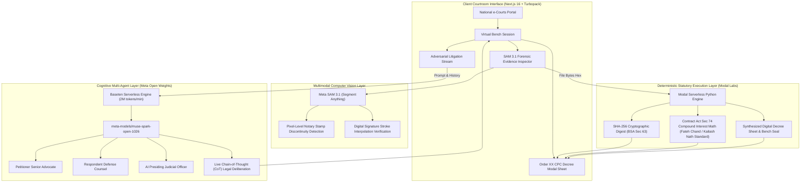

<div align="center">

# ⚖️ AI JUDGE • BHARAT BENCH
### **Autonomous Multimodal Digital Courtroom & Sovereign Judicial Infrastructure**
*Department of Justice • e-Courts Mission Mode Project Architecture*

[](https://baseten.co)
[](https://segment-anything.com)
[](https://baseten.co)
[](https://modal.com)
[](https://indiacode.nic.in)
[](LICENSE)

<br/>

**Author:** Mohamed Haarish Sherieff  
**Platform Target:** Ministry of Law & Justice, Government of India • National e-Courts Phase IV  
**Repository:** [https://github.com/MohamedHaarishSherieff/Ai_Judge](https://github.com/MohamedHaarishSherieff/Ai_Judge)

---

</div>

## 📌 Executive Summary & The Problem

The Indian Subcontinent judicial ecosystem faces a staggering crisis of **over 44 million pending cases** across subordinate courts, High Courts, and the Supreme Court. A significant majority of commercial disputes languish for over 5 to 10 years due to repetitive procedural stages:
1. **Evidentiary Authenticity Authentication**: Lengthy debates over digital document integrity under the newly enacted *Bharatiya Sakshya Adhiniyam, 2023 (BSA Section 63)*.
2. **Formulaic Financial Computations**: Disputes over contractual liquidated damages vs. unproved penal rates under *Section 74 of the Indian Contract Act, 1872*.
3. **Decree Formalization Delays**: Prolonged backlog in drafting certified decree sheets pursuant to *Order XX Rule 6 of the Code of Civil Procedure, 1908 (CPC)*.

**AI Judge (Bharat Bench)** is an autonomous multimodal virtual courtroom platform designed to transition digital judiciaries from passive video meetings into active, machine-verified adjudications.

---

## 🏛️ The Dual-Engine Architecture (Cognitive + Deterministic)

Legal technology demands **zero hallucination tolerance**. AI Judge solves the fundamental limitation of standard generative AI by separating the platform into two symbiotic layers:



### 1. Cognitive Layer — Meta Muse Spark Open (`meta-models/muse-spark-open-1026`)
- Hosted on **Baseten** with 2,000,000 tokens/minute throughput.
- Orchestrates multi-agent adversarial oral litigation between **Petitioner Senior Advocate**, **Respondent Defense Counsel**, and the **AI Presiding Judge**.
- Exposes native **Chain-of-Thought (CoT) Legal Deliberations** directly in the UI, allowing observers to audit the model's statutory reasoning.

### 2. Forensic Vision Layer — Meta Segment Anything (`SAM 3.1`)
- Zero-shot segmentation on uploaded legal instruments (contracts, promissory notes, affidavits).
- Detects non-contiguous pixel distributions in notary stamps, composite overlay signatures, and fraudulent typeface alterations.

### 3. Deterministic Statutory Layer — Modal Labs Serverless
- High-performance Python container executing pure mathematical calculations without variance.
- Calculates compounding contractual interest (quarterly/monthly) and strictly caps unreasonable penal sums per *Kailash Nath Associates v. DDA (2015)*.
- Issues digital Section 63 BSA certificates and signs decree sheets with SHA-256 cryptographic digests.

---

## 🇮🇳 Authentic Indian Judiciary Aesthetic

In compliance with the **Advocates Act, 1961 (Section 49)** and **Bar Council of India Rules**, AI Judge departs from generic tech gradients to reflect the solemn majesty of the Indian Court:
- **Bar Council Palette**: Deep Obsidian Black robes (`#000000`), stark white advocate neck band collars (`#ffffff`), and dark judicial chamber mahogany.
- **State Emblem of India**: High-resolution Ashoka Lion Capital crest sculpted in white marble on black granite bearing *सत्यमेव जयते* (*Truth Alone Triumphs*).
- **Supreme Court Architectural Backdrops**: Grand neoclassical judicial bench backdrops embedded as atmospheric watermarks across chambers and dockets.
- **Scales of Justice & Indian Law Reports**: Authentic leather-bound legal report archives and bronze balance scales.

---

## 📜 Statutory Frameworks Enforced

| Statute | Section / Order | Legal Function in AI Judge |
| :--- | :--- | :--- |
| **Bharatiya Sakshya Adhiniyam, 2023 (BSA)** | **Section 63(1)-(4)** | Admissibility of electronic records and mandatory SHA-256 cryptographic hash certification. |
| **Code of Civil Procedure, 1908 (CPC)** | **Order XX Rule 6** | Autonomous generation of legally enforceable decree sheets containing findings, reliefs, and costs. |
| **Indian Contract Act, 1872** | **Section 74** | Liquidated damages calculation and statutory mitigation of penal interest rates. |
| **Constitution of India** | **Article 39A** | Equal justice and free legal assistance via automated procedural structuring. |
| **Supreme Court Precedent** | *Kailash Nath v. DDA (2015)* | Prevents automated award of liquidated damages without verifiable legal proof of actual loss. |

---

## 💻 Tech Stack

- **Framework**: Next.js 16 (Turbopack, App Router, React Server Components)
- **Styling**: Tailwind CSS, Lucide Icons, Glassmorphism Judicial UI
- **AI Models**:
  - `meta-models/muse-spark-open-1026` (Meta Open Weights on Baseten)
  - `meta-models/sam-3-1` (Meta Segment Anything for Document Forensics)
- **Cloud Infrastructure**:
  - **Baseten Inference**: Serverless LLM endpoint running at 2M tokens/min
  - **Modal Labs**: Python serverless compute sandbox (FastAPI, Pydantic, Hashlib)
- **Deployment**: Vercel / Docker / Local Node.js v20+

---

## 🚀 Quickstart Guide (Local Setup in 60 Seconds)

### 1. Clone Repository
```bash
git clone https://github.com/MohamedHaarishSherieff/Ai_Judge.git
cd Ai_Judge
```

### 2. Configure Environment Variables
Copy `.env.example` to `.env.local`:
```bash
cp .env.example .env.local
```

Ensure your `.env.local` contains your Baseten and Modal credentials:
```env
BASETEN_API_KEY=your_baseten_key
BASETEN_BASE_URL=https://inference.baseten.co/v1
BASETEN_MODEL=meta-models/muse-spark-open-1026

MODAL_API_ENDPOINT=https://mohamedhaarishsherieff--ai-judge-legal-engine-fastapi-app.us-east.modal.run
```

### 3. Install Dependencies & Launch
```bash
npm install
npm run dev
```

Open [http://localhost:3000](http://localhost:3000) in your browser.

---

## 🧪 Testing the Live Engines

### Test 1: Adversarial Trial Simulation
1. Navigate to [http://localhost:3000/text-courtroom/AJ-2026-001](http://localhost:3000/text-courtroom/AJ-2026-001).
2. Click **"Simulate Adversarial Trial (Muse Spark)"**.
3. Watch Petitioner and Respondent counsels argue live, followed by the AI Presiding Judge's ruling.
4. Click **"Muse Spark Legal Deliberation (Chain of Thought)"** on any message to inspect the model's raw statutory reasoning.

### Test 2: Multimodal SAM 3.1 Forensic Inspection
1. Click **"Inspect Exhibit (SAM 3.1)"** in the courtroom toolbar.
2. Toggle bounding box masks for disputed signature strokes and notary stamp ink discontinuities.
3. Verify the electronic Section 63 BSA compliance certificate.

### Test 3: Order XX CPC Decree Synthesis
1. Click **"Synthesize Decree (Order XX CPC)"**.
2. Inspect the synthesized High Court decree sheet with calculated principal sum, statutory interest (18% p.a.), taxed legal costs, and cryptographic SHA-256 seal.

---

## 🎯 Model Architecture & Technical Infrastructure

- **Cognitive Reasoning Engine**: Powered by Meta's open-weights model suite (`meta-models/muse-spark-open-1026`) via Baseten serverless inference.
- **Forensic Vision Engine**: Meta Segment Anything (`SAM 3.1`) for document morphological analysis.
- **Deterministic Statutory Sandbox**: Modal Labs serverless Python environment for cryptographic hashing and interest arithmetic.

---

## ⚖️ Responsible AI & Ethical Disclosure

AI Judge is engineered strictly as a **decision-support and procedural-acceleration system** for advocates, tribunals, and judges. Substantive constitutional discretion, fundamental rights determinations under Articles 32 and 226 of the Constitution of India, and criminal sentencing remain exclusively reserved for human judicial officers.

---

## 📄 License & Attribution

Designed and developed by **Mohamed Haarish Sherieff** (`mohamedhaarishsherieff@gmail.com`).  
Licensed under the [MIT License](LICENSE).
